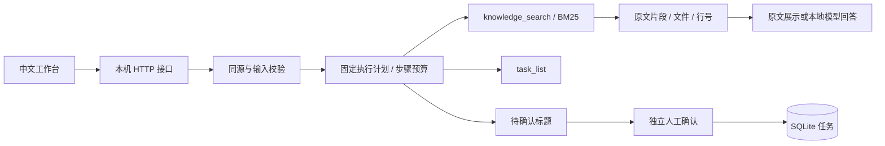

# Evidence Agent

一个可在本机运行的知识库助手：导入 Markdown / TXT，按关键词查找证据，查看文件与行号引用，并在人工确认后创建待办。

这是 **AI 辅助开发的个人学习作品**，用于展示检索、工具边界、HTTP 接口与持久化的工程实现。它不代表商业生产系统或实习经历。默认无需模型、密钥或收费服务即可运行。

## 快速启动

要求 Python 3.10 或更高版本。运行时只使用 Python 标准库，前端是原生 HTML / CSS / JavaScript，无 CDN 依赖。

```bash
git clone https://github.com/bigbang1438/evidence-agent.git
cd evidence-agent
python -m evidence_agent.server
```

浏览器访问 **http://127.0.0.1:8788**。首次启动会导入 `samples/` 中的两份原创示例文档。数据写入 `runtime/state.db`，运行数据不提交到仓库。

可修改端口或使用独立数据目录：

```bash
python -m evidence_agent.server --port 8789 --data-dir ./my-data --no-seed
```

### 体验一次完整流程

1. 点击“工具调用的安全边界”，再点击“检索并回答”。
2. 展开引用，查看文件名、原文行号与文本；右侧展示检索工具的执行耗时。
3. 展开“同时提出一条待办”，输入标题，例如“补充工具白名单测试”，再提问。
4. 右侧先出现待确认请求，此时任务列表还没有变化。
5. 点击“确认创建”，任务才写入 SQLite。刷新页面后任务仍保留。点击“放弃”则不创建。

提问或文档中的“立刻创建任务”等指令不会自动提出、审批或写入任务。创建标题来自独立表单。

## 两种模式

| 模式 | 实际行为 | 是否需要模型 |
|---|---|---|
| 演示模式（默认） | 固定执行计划调用 BM25 检索，并逐字展示匹配片段；按问题关键词决定是否读取任务 | 不需要，不进行大模型推理 |
| 本地 Ollama | 使用同一检索与工具边界，将找到的片段交给已配置的本机模型生成回答 | 需要用户已有的本地 Ollama 与模型 |

本项目没有语义向量检索、模型训练、多 Agent 协作或自主任务规划。模型只负责对检索证据生成文本，**没有工具执行和审批权限**。模型答案可能存在错误，来源卡片是原文证据，需人工核对。

### 可选接入 Ollama

先安装并启动 Ollama，确保所选模型已经在本机可用。项目不会下载模型或调用云端付费接口。

PowerShell：

```powershell
$env:OLLAMA_HOST = 'http://127.0.0.1:11434'
$env:OLLAMA_MODEL = '替换为本机已安装的模型名'
python -m evidence_agent.server
```

macOS / Linux：

```bash
OLLAMA_HOST=http://127.0.0.1:11434 OLLAMA_MODEL='替换为本机已安装的模型名' python -m evidence_agent.server
```

环境变量只在服务端读取；浏览器不能传入模型地址或覆盖模型名。`OLLAMA_HOST` 只允许 HTTP loopback 地址（`localhost` / `127.0.0.1` / `::1`），不允许凭证、路径、查询参数、重定向或外部代理。已配置不表示模型服务健康，请求失败时界面会说明。

适配器遵循 [Ollama 官方 Chat API](https://docs.ollama.com/api/chat)：`POST /api/chat`，发送 `model`、`messages`、`stream: false`，读取 `message.content`。模型输出上限 512 token，响应体上限 64 KiB。

## 工程实现



- **文档导入**：仅接收 UTF-8 Markdown / TXT；文件名白名单禁止路径、隐藏文件、系统保留名；单文件不超过 256 KiB，知识库最多 30 个文件、合计 1 MiB。文件内容存入 SQLite，不使用用户文件名构建磁盘路径。同名导入拒绝覆盖。
- **可追溯检索**：按行切分为不超过 600 字符的片段，保留原始行号。英文词项与中文字符、二元词组参与 BM25 排序，返回前三条匹配证据。空检索不编造答案。索引在每次查询时根据已保存片段计算，适合受限的小规模本地资料。
- **工具白名单**：只允许 `knowledge_search`、`task_list`、`task_create`，且严格校验参数。没有任意 URL、代码执行、shell 或文件系统工具。
- **写入控制**：Agent 调用写工具时默认拒绝，转为服务端保存的确认请求。确认 ID 绑定原始标题，在事务中一次性消费；拒绝请求不会创建任务。
- **执行边界**：最多 6 个步骤；工具间检查 20 秒整体时间预算，模型 HTTP 请求带超时。超时或超预算后不继续执行后续写工具。网络超时属于请求读写超时，不是对阻塞 I/O 或数据库操作的硬实时抢占。
- **可观测性**：返回工具名、状态、摘要、逐步耗时与总耗时；当前运行轨迹显示在界面，不长期保存问答日志。
- **HTTP 防护**：仅绑定 `127.0.0.1`；校验 Host / Origin，写接口需要启动时生成的 CSRF token；JSON 请求上限 768 KiB；写请求每分钟最多 60 次；同一时刻只允许一次 Agent 运行。前端用 `textContent` 渲染用户文本，使用严格 CSP，不依赖内联脚本或 `eval`。

这是同一台电脑上的单用户学习工具，没有账号隔离、外网部署或多用户授权机制，请保持默认本机访问方式。

## API 摘要

写请求使用 `Content-Type: application/json` 和 `X-CSRF-Token`。token 由 `GET /api/state` 返回，服务重启后需重新获取。

| 方法 / 路径 | 用途 |
|---|---|
| `GET /api/health` | 服务健康与本地模型配置标志 |
| `GET /api/state` | 文档、任务、待确认项与 CSRF token |
| `POST /api/documents` | `{filename, content}` 导入文档；返回 201 与 Location |
| `POST /api/runs` | `{question, mode?, draft_task_title?}` 执行计划 |
| `GET /api/tasks` | 返回最近 100 条已确认任务 |
| `POST /api/approvals/{id}` | `{approved: true或false}` 处理确认请求 |

未知字段、非法路径和输入返回 422；非法 JSON 返回 400；校验失败返回 403；请求过大返回 413；频率超限返回 429；模型失败返回 502；忙碌返回 503。错误格式统一为 `{error: {code, message}}`，不返回异常堆栈、凭证或模型响应原文。

## 测试

运行时没有第三方依赖；测试使用 pytest：

```bash
python -m pip install 'pytest>=8,<10'
python -m pytest -q
```

测试覆盖检索原文与行号、无匹配结果、长行切分、文档尺寸与路径、工具白名单、未经确认禁止写入、同一确认不可重放、拒绝不写入、重启持久化、步骤与时间预算、Host / Origin / CSRF 校验、HTTP 请求尺寸、执行并发与频率边界，以及 Ollama 请求 / 响应合约。

Ollama 测试使用本机 HTTP stub 检查协议与错误处理，**未实测真实模型推理质量、问答准确率或语义召回率**。自动化通过数量可通过测试命令复现，不将测试通过数当作业务准确率。

## 目录

```text
evidence_agent/core.py     文档、BM25、SQLite 与工具策略
evidence_agent/ollama.py   本地模型适配器
evidence_agent/server.py   HTTP 路由与输入边界
web/                      中文原生工作台
samples/                  原创示例资料
tests/                    可运行行为测试
runtime/                  自动生成的本机数据（忽略）
```

## 许可

项目原创代码采用 [MIT License](LICENSE)。用户导入的资料仍遵循其原有权利与许可，不随本项目再分发。
