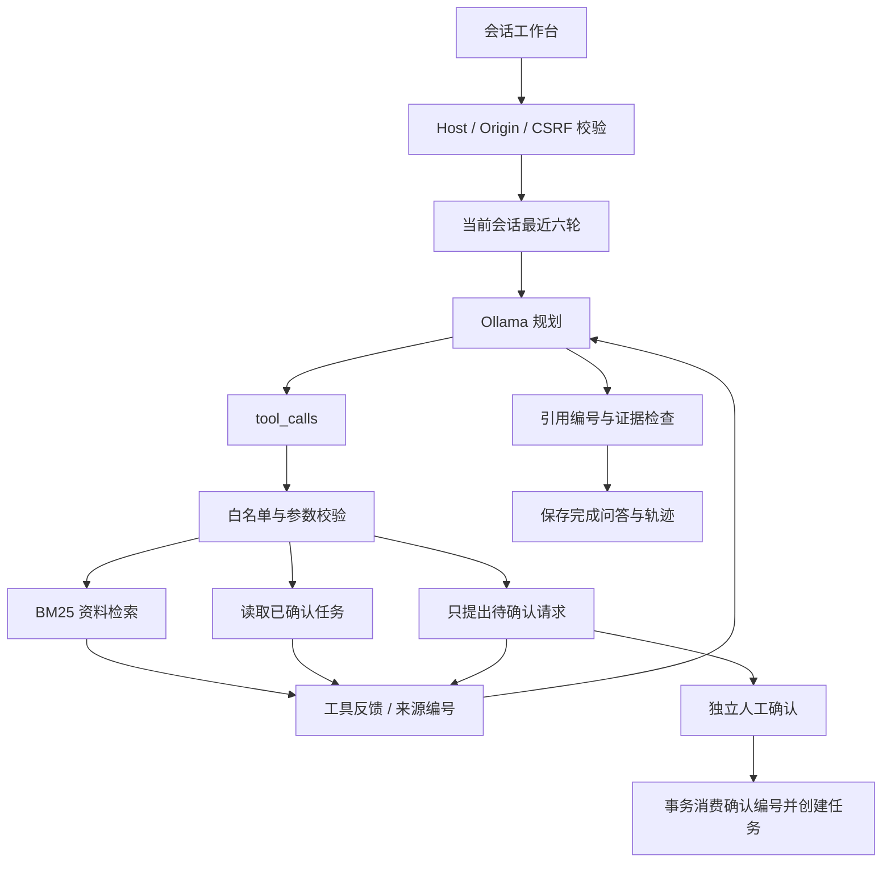

# Evidence Agent

在本机运行的知识与待办助手：导入 Markdown / TXT，由本地模型选择白名单工具，读取工具反馈后继续回答；知识结论附来源，任务写入必须人工确认。会话、问答和工具轨迹保存到 SQLite。

这是 **AI 辅助开发的个人实践作品**，不是实习或商业生产经历。默认免费演示模式不需要模型、密钥或云端付费服务。模型模式需要用户已有的 Ollama 与支持工具调用的本地模型。

## 启动

运行时只依赖 Python 3.10+ 标准库；前端为原生 HTML / CSS / JavaScript，无 CDN。

```bash
git clone https://github.com/bigbang1438/evidence-agent.git
cd evidence-agent
python -m evidence_agent.server
```

访问 [http://127.0.0.1:8788](http://127.0.0.1:8788)。首次启动导入 `samples/` 原创资料。数据位于 `runtime/state.db`，不会提交到 GitHub。

```bash
python -m evidence_agent.server --port 8790 --data-dir ./my-data --no-seed
```

### 免费演示

1. 提问“工具调用有哪些安全边界？”，展开来源卡片核对文件名、行号与原文。
2. 在“同时提出一条待办”中输入标题后提问。此时只有确认队列变化，任务列表没有写入。
3. 单独点击“确认创建”或“放弃”。同一确认 ID 只能处理一次。
4. 继续提问形成多轮会话，刷新后通过左侧会话历史查看问答；点击某一轮可恢复来源与轨迹。
5. 点击“新会话”开始新的上下文。其他会话不会进入模型提示。

演示模式是固定工作流与原文摘录，**不是模型自主推理**。历史会持久保存，但演示模式不会对代词追问进行智能改写。

### 本地模型模式

确保 Ollama 已运行且模型支持工具调用。项目不会自动安装或下载模型，也不调用付费云端接口。

PowerShell：

```powershell
$env:OLLAMA_HOST = 'http://127.0.0.1:11434'
$env:OLLAMA_MODEL = '替换为已安装且支持工具调用的模型'
python -m evidence_agent.server --port 8790 --data-dir ./my-data
```

macOS / Linux：

```bash
OLLAMA_HOST=http://127.0.0.1:11434 OLLAMA_MODEL='替换为本机模型' python -m evidence_agent.server
```

配置仅由服务端读取，浏览器不能替换模型名或地址。模型地址仅允许 HTTP loopback，禁止路径、凭证、查询参数、代理与重定向。“已配置”只代表参数存在，不代表模型服务健康。首次加载模型可能较慢；默认 90 秒整体预算不足时请求会失败，不会继续执行写工具。

协议遵循 [Ollama Chat API](https://docs.ollama.com/api/chat) 和 [官方工具调用流程](https://docs.ollama.com/capabilities/tool-calling)：发送 `messages`、JSON Schema `tools`、`stream:false`，读取 `message.tool_calls`，执行白名单工具，再将 `role:tool` 与 `tool_name` 的结果回传模型。关闭额外思考输出，温度为 0，单轮最多生成 512 token、响应体不超过 64 KiB。

## 核心设计



### 模型驱动循环

- 模型可自主选择 `knowledge_search`、`task_list`、`task_create`。工具调用的名称和参数由服务器验证；未知工具、额外字段和 `approved:true` 会成为拒绝 observation，不能触发写入。
- 工具反馈回到模型后继续规划，直到没有新调用或达到预算。最多 **8 步**，模型轮次与工具分别计数；不是“8 次模型请求加无限工具”。整体默认 90 秒，在模型响应后与工具前再次检查。HTTP 设置有限超时，但不是对阻塞 I/O 的硬实时抢占。
- 每次调用分配服务器 `call_id`，保存名称、参数、状态、结果、逐步耗时与总耗时。界面可展开输入与反馈，不存模型隐含推理。system / history / user / assistant / 工具 observation 和 schema 合计最多 16,000 字符，超过则停止下一轮请求；这是字符预算，不是精确 token 预算。`task_list` 的模型 observation 只含最新 20 条并说明截断。
- `task_create` 只提出确认，模型没有审批工具。重复写请求共用本轮唯一待确认项；确认 ID 绑定原始标题与会话，确认接口校验当前会话，用事务和唯一约束防止重放。页面仅显示当前会话的确认队列。模型文案不能改变任务状态，页面会明确显示“尚未创建”。

### 会话与上下文

- SQLite 保存会话与已完成的运行记录，包括用户问题、答案、引用与轨迹；刷新或重启可恢复。
- 模型只接收当前会话最近 **6 轮**问答，合计不超过 **12,000 字符**；旧的工具消息不重新作为工具指令播放。这是截断历史策略，没有长记忆压缩、语义记忆或跨会话检索。
- 本地存储最多 100 个会话、每个会话 50 轮。浏览器只保存当前会话 ID，CSRF token 每次从服务读取。运行失败可能留下此前提出的待确认项，但不会自动创建任务；刷新后可以处理该项。

### 检索与证据

- Markdown / TXT 按行切为不超过 600 字符的片段，保留文件、`chunk_id`、起止行号与原文。
- BM25 使用英文词项及中文二元词组，中文单字符降权；有多字符查询词项时，只有单字符重合不作为证据。模型可结合历史改写搜索词并多次检索，去重后累计最多 12 条来源。
- 这是**词法检索**，没有 embedding、向量数据库或神经重排。索引每次查询由保存的片段计算，适合受限的小资料库，不宣称大规模吞吐性能。
- 无证据时拒绝知识结论；有证据时要求有效 `[n]` 引用，缺失或不存在的编号会拦截结论。编号合法只能证明关联到真实片段，不能自动证明每句话受该片段支持。只读取任务时使用服务端任务观察生成状态文本，防止模型编造未引用的知识结论。

### 安全边界

- 服务仅绑定 `127.0.0.1`，验证 Host / Origin 与启动时生成的 CSRF token；JSON 上限 768 KiB，写请求每分钟 60 次；一次只执行一个 Agent 请求。
- 文档仅允许 UTF-8 `.md` / `.txt`，文件名禁止路径、隐藏文件和系统保留名；单文件 256 KiB、合计 1 MiB、最多 30 文件。同名导入拒绝覆盖。用户文件名不会组成磁盘路径。
- 参数化 SQL、外键、唯一约束、SQLite WAL 与事务；确认消费和任务创建保持原子性。
- 前端使用 `textContent` 展示资料与工具反馈，严格 CSP 禁止内联脚本与 `eval`。
- 没有 shell、任意 URL、代码执行、私有文件读取或模型审批能力。文档提示注入无法增加这些工具；仍不能保证模型所有文本判断免受注入影响，重要结论须核对原文。

这是同一台电脑上的单用户学习应用，没有账户隔离或多租户授权，请保持默认本机访问方式。

## 原创离线评测

```bash
python -m evidence_agent.evaluate --output evaluation/report.json
```

固定数据位于 [evaluation/dataset.json](evaluation/dataset.json)，包含 8 份原创工程说明、20 道有黄金片段的问题及 4 道无答案问题。黄金片段用人工指定的文件名与行号标识，结果详情见 [evaluation/report.json](evaluation/report.json)。

| 指标 | 本次结果 | 含义 |
|---|---:|---|
| Recall@1 | 0.900 | 每题黄金片段在首条结果中的召回比例，宏平均 |
| Recall@3 | 1.000 | 每题黄金片段在前三条结果中的召回比例，宏平均 |
| MRR@3 | 0.975 | 前三条中首个相关结果倒数排名的平均值 |
| 原文可追溯覆盖率 | 43 / 43 | 返回片段与源文件对应行号文本完全一致 |
| 无答案检索拒答率 | 4 / 4 | 4 道固定负例没有返回词法匹配结果 |

这是一个**小型固定词法检索集**，尚未做盲测或独立保留集。问题与资料同时公开，结果不能代表陌生领域、语义改写或规模扩张后的表现。原文可追溯覆盖率不等于引用语义支持率，以上指标也**不是 LLM 问答准确率**。当前数据集文档均为短文本，长文切分另由行为测试验证。

## API

写请求需 `Content-Type:application/json` 与 `X-CSRF-Token`，token 由 `GET /api/state` 返回。

| 方法 / 路径 | 用途 |
|---|---|
| `GET /api/state` | 资料、会话列表、任务、待确认项与 CSRF token |
| `GET /api/health` | 服务健康与模型配置标志 |
| `POST /api/documents` | `{filename,content}` 导入资料 |
| `GET /api/conversations` | 会话摘要与轮数 |
| `POST /api/conversations` | `{title}` 创建空会话 |
| `GET /api/conversations/{id}` | 已保存问答、引用、轨迹 |
| `POST /api/runs` | `{question,mode?,conversation_id?,draft_task_title?}`；无会话 ID 自动创建 |
| `GET /api/tasks` | 最近 100 条已确认任务 |
| `POST /api/approvals/{id}` | `{approved:true或false,conversation_id}` 独立处理当前会话确认请求 |

统一错误格式 `{error:{code,message}}`：400 非法 JSON；403 跨站 / CSRF；413 请求过大；422 输入或预算；429 频率；502 模型失败；503 忙碌 / 存储不可用。不返回堆栈、模型原始错误或本机文件路径。

## 验证

```bash
python -m pip install 'pytest>=8,<10'
python -m pytest -q
```

测试覆盖检索原文 / 行号、尺寸 / 路径、工具参数边界、模型调用与 observation 循环、假引用、恶意文档不得审批、重复提案与审批重放、多轮历史重启与会话隔离、步骤 / 时间预算、HTTP Host / Origin / CSRF、频率 / 并发及 Ollama tools 合约。Ollama 协议测试用本机 HTTP stub 和脚本模型隔离慢依赖，不能充当真实模型质量实测。

2026-10-13 使用 Ollama 0.40.3 与 `qwen3:0.6b` 做了 3 次真实网页冒烟。明确指定工具时出现了检索及 observation 回传，但普通中文提问没有稳定触发工具；两次知识请求均被证据或引用规则拦截，未得到符合要求的最终回答。详见 [真实模型开发冒烟记录](docs/real-model-smoke.md)。这 3 次观察不构成可靠自主规划、问答准确率或质量提升的统计结论。

详细设计取舍与扩展方向见 [docs/architecture.md](docs/architecture.md)。MIT 许可适用于本项目原创代码；用户资料仍保留原有权利与许可。
